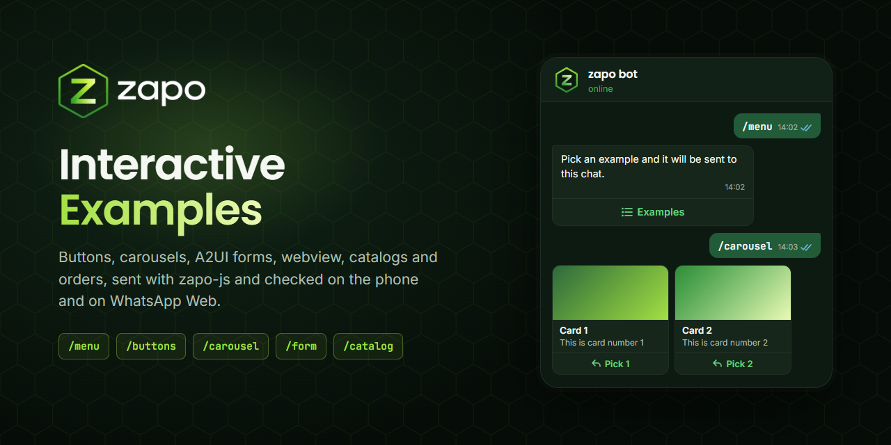

<p align="center">
  
</p>

<h1 align="center">zapo-interactive-examples</h1>

<p align="center">
  <strong>Real, tested WhatsApp interactive messages with zapo-js: buttons, carousels, A2UI forms, webview, catalog products, catalog messages and order replies, plus a test bot that sends any of them to your phone.</strong>
</p>

<p align="center">
  <sub>Community examples, not an official <a href="https://github.com/vinikjkkj/zapo">zapo</a> project.</sub>
</p>

<p align="center">
  <a href="https://github.com/jobasfernandes/zapo-interactive-examples/actions/workflows/ci.yml"><picture><source media="(prefers-color-scheme: dark)" srcset="https://www.shieldcn.dev/github/ci/jobasfernandes/zapo-interactive-examples.svg?workflow=ci.yml&amp;branch=main&amp;variant=secondary&amp;size=sm&amp;mode=dark"></picture></a>
  <a href="LICENSE"><picture><source media="(prefers-color-scheme: dark)" srcset="https://www.shieldcn.dev/github/license/jobasfernandes/zapo-interactive-examples.svg?variant=ghost&amp;size=sm&amp;mode=dark"></picture></a>
  <a href="https://github.com/jobasfernandes/zapo-interactive-examples/commits/main"><picture><source media="(prefers-color-scheme: dark)" srcset="https://www.shieldcn.dev/github/last-commit/jobasfernandes/zapo-interactive-examples.svg?variant=secondary&amp;size=sm&amp;mode=dark"></picture></a>
  <a href="https://github.com/jobasfernandes/zapo-interactive-examples/stargazers"><picture><source media="(prefers-color-scheme: dark)" srcset="https://www.shieldcn.dev/github/stars/jobasfernandes/zapo-interactive-examples.svg?variant=secondary&amp;size=sm&amp;mode=dark"></picture></a>
</p>

<p align="center">
  <a href="https://www.typescriptlang.org/"><picture><source media="(prefers-color-scheme: dark)" srcset="https://www.shieldcn.dev/badge/Language-TypeScript-3178C6.svg?logo=typescript&amp;variant=branded&amp;size=sm&amp;mode=dark"></picture></a>
  <a href="https://nodejs.org/"><picture><source media="(prefers-color-scheme: dark)" srcset="https://www.shieldcn.dev/badge/Runtime-Node.js_20.12+-5FA04E.svg?logo=nodedotjs&amp;variant=branded&amp;size=sm&amp;mode=dark"></picture></a>
  <a href="https://github.com/vinikjkkj/zapo"><picture><source media="(prefers-color-scheme: dark)" srcset="https://www.shieldcn.dev/badge/WhatsApp-zapo--js_1.10-25D366.svg?logo=whatsapp&amp;variant=branded&amp;size=sm&amp;mode=dark"></picture></a>
  <a href="https://vitest.dev/"><picture><source media="(prefers-color-scheme: dark)" srcset="https://www.shieldcn.dev/badge/Tests-Vitest-6E9F18.svg?logo=vitest&amp;variant=branded&amp;size=sm&amp;mode=dark"></picture></a>
</p>

---

### Table of Contents

- [Overview](#overview)
- [Key Features](#key-features)
- [Quick Start](#quick-start)
- [Who Can Use the Bot](#who-can-use-the-bot)
- [Commands](#commands)
- [Send One Example Without the Bot](#send-one-example-without-the-bot)
- [Configuration](#configuration)
- [Meta-Hosted Banner](#meta-hosted-banner)
- [Project Structure](#project-structure)
- [Known Limitations](#known-limitations)
- [Documentation](#documentation)
- [Development](#development)
- [Contributing](#contributing)
- [License](#license)

### Overview

This repository is for developers who use [zapo-js](https://github.com/vinikjkkj/zapo) and want **working** examples of WhatsApp interactive messages. Each message type lives in one short file you can read and copy, and a small test bot sends any of them to the chat you ask from.

Every example here was checked on an Android phone and on WhatsApp Web. What renders where, and the protocol details that make the difference (like the stanza name Android needs to open an A2UI form), are in [docs/delivery-matrix.md](docs/delivery-matrix.md) and [docs/gotchas.md](docs/gotchas.md).

### Key Features

- **Buttons** -- legacy `buttonsMessage`, native flow quick replies and CTA buttons (link, call, copy)
- **Carousel** -- image cards with a quick reply and a link each
- **A2UI form** -- multi-step `form_message` that opens on the phone and on Web
- **Webview** -- link button that opens a page inside WhatsApp on the phone
- **Catalog** -- product cards, product carousels with native catalog buttons, the `wa.me/c` catalog share and the interactive `catalog_message`
- **Orders** -- the seller's `review_and_pay` cards, sent as a reaction to a buyer's cart
- **PIX** -- the static PIX key card and a PIX charge that opens the native payment flow on the phone
- **Test bot** -- `/commands` and a list menu, access limited to allowed numbers and groups
- **Send CLI** -- one example to one chat, no bot needed

### Quick Start

Requirements:

- Node.js 20.12 or newer
- A WhatsApp account to pair as a linked device (it is the bot's identity)
- For the catalog examples only: a **WhatsApp Business** account with a catalog that has already shared its products at least once from the app (open any chat, attach > Catalog, send the products and the catalog). zapo has no catalog API yet, so the examples read the products from the messages the account already sent (see [docs/catalog-api-research.md](docs/catalog-api-research.md)).

```bash
npm install
cp .env.example .env   # optional, every variable has a default
npm start
```

On the first run a QR code shows up in the terminal: scan it in WhatsApp > Linked devices. The session is kept in `.auth/` (gitignored), so later runs connect straight away.

Then, from the phone of the paired account, open your own chat ("Message yourself") and type `/menu`. Typing it in a contact's chat works too, but the examples are then sent to that contact.

Run one process per session: the bot and the send CLI cannot share the same `AUTH_PATH` and `SESSION_ID` at the same time (WhatsApp drops the older connection).

### Who Can Use the Bot

Commands always start with `/`; plain text never triggers the bot.

| Where | Who is answered |
|---|---|
| Your own chat ("Message yourself") | always |
| Any private chat, typed by you (the paired account) | always |
| Private chat with someone else | numbers listed in `ALLOWED_NUMBERS` |
| Group | only groups in `ALLOWED_GROUPS`, and only when the sender is in `ALLOWED_NUMBERS` (or is you) |

Everyone else is ignored; their commands are logged to `logs/bot.log` as `DENIED` so you can check the allowlists. Write numbers the way WhatsApp stores them (in Brazil that is often without the extra ninth digit). Type `/groups` in your own chat to get the id of a group for `ALLOWED_GROUPS`.

### Commands

| Command | Sends | Needs a catalog |
|---|---|---|
| `/menu` | a list with every example; picking a row runs it | no |
| `/help` | the command list as text | no |
| `/buttons` | legacy buttons, quick reply buttons, CTA buttons (link, call, copy) | no |
| `/carousel` | generic carousel: image cards with a quick reply and a link | no |
| `/form` | A2UI multi-step form (`form_message`) | no |
| `/webview` | link button that opens a page inside WhatsApp on the phone | no |
| `/pix` | PIX key card (`payment_info`) with a "copy PIX key" button | no (Business) |
| `/charge [amount]` | charge card (`review_and_pay`) paid with PIX; R$ 0,01 by default | no (Business) |
| `/product` | catalog product cards | yes |
| `/catalog [product\|all\|mixed]` | carousel of catalog products; the card button opens the product, the whole catalog, or alternates | yes |
| `/catalog-link` | the catalog share the WhatsApp app sends (`wa.me/c` link preview) | yes |
| `/catalog-message [product]` | interactive `catalog_message`: one button that opens the catalog | yes |
| `/groups` | the account's groups and their ids (only in your own chat) | no |

The bot also **reacts to carts**: when an allowed contact sends a cart from your catalog, it answers with the two order cards a seller sends (accept and decline), quoting the cart. Button and form answers are written to `logs/bot.log`.

### Send One Example Without the Bot

```bash
npm run send -- <command> <phone-digits | group-jid> [args...] [--label "text"]
npm run send -- carousel 5511999999999
npm run send -- catalog 120363000000000000@g.us mixed
```

`--label` sends a plain text first, handy to number a batch of manual tests.

### Configuration

All variables are optional; see [.env.example](.env.example). A `.env` file in the project root is read on start, and variables already set in the shell win.

| Variable | Default | Meaning |
|---|---|---|
| `AUTH_PATH` | `.auth/session.sqlite` | SQLite file with the paired session |
| `SESSION_ID` | `default` | session id inside that file |
| `ALLOWED_NUMBERS` | empty | phone numbers (digits with country code, comma separated) |
| `ALLOWED_GROUPS` | empty | group ids (comma separated) |
| `LOG_LEVEL` | `warn` | zapo-js log level |
| `CTA_URL` | `https://github.com/vinikjkkj/zapo` | link of `cta_url` buttons |
| `WEBVIEW_URL` | `https://github.com/vinikjkkj/zapo` | page opened by `/webview` |
| `IMAGE_URL` | `https://placehold.co/640x640/png` | image of the generic carousel cards |
| `CTA_CALL_NUMBER` | the paired number | number dialed by the `cta_call` button |
| `PIX_KEY` | `+5511982905991` | PIX key shown by `/pix` and `/charge` (the default is the zapo author's, shared with his permission: tips welcome) |
| `PIX_KEY_TYPE` | `PHONE` | `EVP`, `EMAIL`, `PHONE`, `CPF` or `CNPJ` |
| `PIX_MERCHANT_NAME` | `vinikjkkj (zapo)` | name shown as "requested by" |
| `META_HOSTED_BANNER` | `false` | experimental: `true` marks the first message to each private chat as hosted by Meta, with a 👋 before it; read [Meta-Hosted Banner](#meta-hosted-banner) first |

### Meta-Hosted Banner

Experimental and off by default. With `META_HOSTED_BANNER=true`, the first time the bot or the send CLI writes to a private chat in a run, it sends a 👋 stamped end-to-end (`<biz actual_actors="1" host_storage="1" privacy_mode_ts="...">`) and then the real message stamped with the privacy mode of a business hosted by Meta (`actual_actors="2" host_storage="2"`, one second newer). The contact's WhatsApp then shows this system message in that chat:

> This business is now using a secure service from Meta to manage this chat.

Observed on WhatsApp Web and on the phone on 2026-10-16 (in Portuguese: "Esta empresa agora usa um serviço seguro da Meta para gerenciar esta conversa"). Groups, status, channels and your own chat are never stamped.

Before turning it on:

- **It is not true for this bot.** A linked-device session is not hosted by Meta. Use it only with your own test chats.
- **It changes state on the contact's device.** WhatsApp Web records the account as an API business, stops treating the chat as end-to-end encrypted and swaps the encryption line in the contact info for the Meta text, until it re-syncs the business with WhatsApp's servers. Turning the flag off sends nothing to undo it; going back on purpose takes a newer `privacy_mode_ts` with `actual_actors="1" host_storage="1"`, which shows its own "now end-to-end encrypted" message.
- **Why the 👋 first.** Each of the contact's devices shows the banner only when the mode it stored for the business changes. A phone keeps the Meta mode even after the chat is deleted, so the Meta stamp alone showed nothing there the second time; switching to end-to-end first turns it into a change on every device. A device that still had the Meta mode shows "now end-to-end encrypted" right before the banner.
- **Only the first message per chat, per run.** Later messages go out untouched: with every message stamped, WhatsApp Web showed the banner again each time it re-synced the business with the servers, which know this account is not hosted (three times in a new chat). Restart the bot to run the switch again. See entry 12 in [docs/gotchas.md](docs/gotchas.md).

### Project Structure

| File | What to copy from it |
|---|---|
| [src/examples/buttons.ts](src/examples/buttons.ts) | `buttonsMessage`, `quick_reply`, `cta_url` / `cta_call` / `cta_copy` |
| [src/examples/carousel.ts](src/examples/carousel.ts) | `carouselMessage` cards and the `<biz>` node carousels need |
| [src/examples/form.ts](src/examples/form.ts) | A2UI `form_message` payload |
| [src/lib/native-flow-name.ts](src/lib/native-flow-name.ts) | why and how the `form_message` stanza is renamed so Android opens it |
| [src/lib/biz-privacy.ts](src/lib/biz-privacy.ts) | the `<biz>` privacy attrs behind the Meta-hosted banner (`META_HOSTED_BANNER`) |
| [src/examples/webview.ts](src/examples/webview.ts) | `cta_url` with `webview_interaction` |
| [src/examples/product.ts](src/examples/product.ts) | `productMessage` with a re-uploaded image |
| [src/examples/catalog.ts](src/examples/catalog.ts) | carousel with `cta_url` + `cta_catalog` |
| [src/examples/catalog-solo.ts](src/examples/catalog-solo.ts) | `wa.me/c` link preview and `catalog_message` |
| [src/examples/order.ts](src/examples/order.ts) | `review_and_pay` order cards |
| [src/examples/pix.ts](src/examples/pix.ts) | `payment_info` PIX key card and `review_and_pay` PIX charge |
| [src/examples/menu.ts](src/examples/menu.ts) | classic `listMessage` that also renders on WhatsApp Web |
| [src/bot/](src/bot/) | the bot: access rules, command routing, cart reaction |
| [src/cli/send.ts](src/cli/send.ts) | the send CLI |
| [test/](test/) | unit tests for the pure parts (config, access, commands, payload builders) |

### Known Limitations

- The A2UI form opens on Android only because the bot renames the stanza's `<native_flow>` to `form_message`; zapo sends `mixed` for every native flow ([vinikjkkj/zapo#317](https://github.com/vinikjkkj/zapo/issues/317)). The same applies to `catalog_message`.
- A form answered on the phone shows as "Use your phone" on that person's WhatsApp Web: Android always answers with `version: 3`, which Web rejects. The bot receives both answers fine.
- The buyer's cart only carries the item count and the total, so the order cards list your catalog products cycled up to that count: an approximation until the real order details can be fetched.
- Catalog examples need products already shared from the app (no catalog API yet).
- When a recipient's device asks for a message again (retry receipt), zapo rebuilds it without any `<biz>` node: that copy loses the list menu's `<list>` node and the Meta-hosted stamp.

### Documentation

- [docs/delivery-matrix.md](docs/delivery-matrix.md) -- what each format does on the phone and on Web
- [docs/gotchas.md](docs/gotchas.md) -- silent failures, as symptom and cause
- [docs/catalog-api-research.md](docs/catalog-api-research.md) -- what was tried to list a catalog through the API, and next steps

### Development

```bash
npm run typecheck
npm test
```

CI runs both on every push and pull request.

### Contributing

Issues and pull requests are welcome, especially new message types and results from other clients (iPhone, Desktop). Keep each example in its own file, add the observed result to [docs/delivery-matrix.md](docs/delivery-matrix.md), and never commit real phone numbers, LIDs or group ids: use placeholders like `5511999999999` and `120363000000000000@g.us`.

### License

[The Unlicense](LICENSE): public domain, use it however you like.
